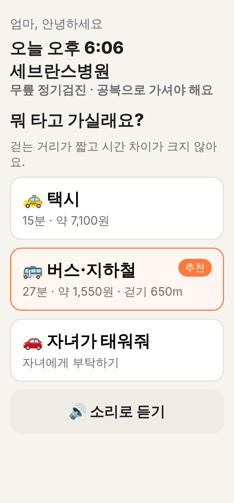
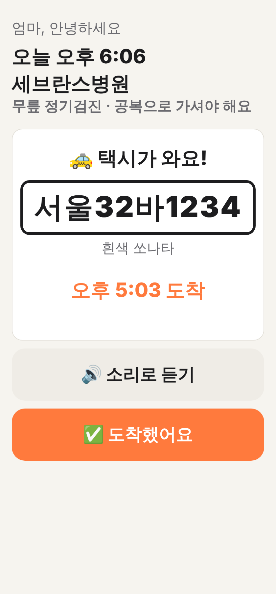
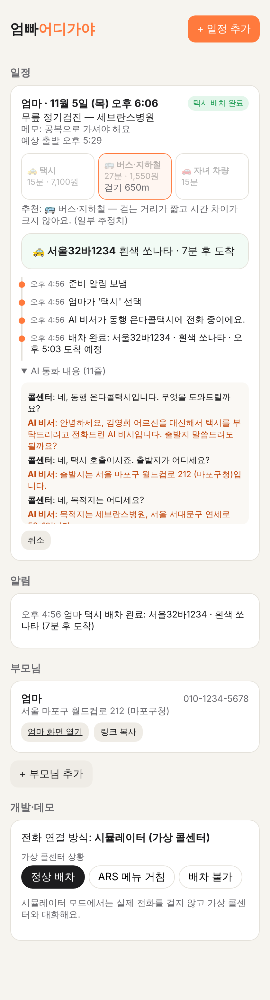

# 엄빠어디가야

엄마·아빠 일정을 자녀가 입력해 두면 당일에 알림을 보내고, "뭐 타고 가실래요?"라고 묻고,
교통수단별 동선을 비교해 보여주고, 택시를 고르시면 **AI 비서가 서울시 동행 온다콜택시에 전화해서 택시를 불러 드리는** 앱이에요.

기능 설계와 화면 흐름은 [docs/DESIGN.md](docs/DESIGN.md)에 있어요.

| 부모님: 뭐 타고 가실래요? | 부모님: 택시가 와요! | 자녀: 일정·AI 통화 내용 |
|---|---|---|
|  |  |  |

## 실행

Node.js 22.18 이상이 필요해요 (TypeScript를 빌드 없이 바로 실행해요).

```bash
npm install
cp .env.example .env   # 필요한 키만 채우면 돼요. 비워 둬도 데모는 동작해요.
npm start              # http://localhost:3000
```

- `http://localhost:3000` — 자녀 화면: 부모님 등록, 일정 추가, 진행 상황, AI 통화 내용
- `http://localhost:3000/p/<링크>` — 부모님 간편 화면 (자녀 화면의 '링크 복사'로 받아요)

데모 순서: 부모님 등록 → 일정 추가 → '지금 물어보기 (데모)' → 부모님 화면에서 '택시' →
가상 콜센터와 AI가 통화 → 차량번호 표시.

```bash
npm test        # 테스트 16개
npm run typecheck
```

## 무엇이 들어 있나 (MVP)

| 기능 | 위치 | 상태 |
|---|---|---|
| 부모님 등록·일정 입력 | `src/app.ts`, `public/guardian.*` | ✅ |
| 자동 알림: 전날 저녁, 출발 60분 전, 30분 전 "뭐 타고 가실래요?", 10분 무응답 시 자녀에게 | `src/flow.ts` | ✅ |
| 교통수단 비교 + 추천 (택시/버스·지하철/자녀 차량) | `src/routes/compare.ts` | ✅ 키 없으면 추정치 |
| AI 비서 택시 전화 호출 | `src/call/` | ✅ 시뮬레이터 / ⚠️ 실제 전화는 실험적 |
| 실패 시 재시도(최대 3번) → 자녀에게 넘기기, 운영시간(8~22시) 확인 | `src/call/service.ts` | ✅ |
| 부모님 간편 화면 (큰 글씨, 버튼 3개, 소리로 듣기) | `public/parent.*` | ✅ |
| 자녀 타임라인·통화 기록 | `public/guardian.*` | ✅ |

### AI 비서 통화 구조

```
콜센터 음성 ──(음성 인식)──▶ CallService.onCenterUtterance()
                                   │
                                   ▼
                           CallAgent.next(브리핑, 통화 내용)
                           ├─ ClaudeCallAgent: Claude가 다음 말·ARS 버튼·배차 정보(차량번호·도착시간)를 구조화해서 돌려줌
                           └─ RuleBasedCallAgent: API 키가 없거나 Claude 실패 시 규칙 기반으로 대신함
                                   │
                                   ▼
                       말하기(TTS) / 버튼 누르기 / 배차 완료 → 부모님·자녀 알림
```

전화 제공자는 `CALL_PROVIDER`로 바꿔요.
- `simulator` (기본): 실제 전화 없이 가상 콜센터와 대화해요. 화면의 '개발·데모'에서 정상 배차 / ARS 메뉴 / 배차 불가 상황을 고를 수 있어요.
- `twilio`: Twilio 음성 API로 실제 발신해요 (`<Gather>`로 음성 인식, `<Say>`로 음성 합성). **실제 통화로는 아직 시험하지 않았어요.**

## 외부 서비스 키 (.env)

| 변수 | 용도 | 없으면 |
|---|---|---|
| `ANTHROPIC_API_KEY` | AI 비서 대화 (Claude) | 규칙 기반 비서 |
| `KAKAO_REST_API_KEY` | 장소 검색, 자동차 길찾기·택시요금 | 샘플 장소 10곳, 직선거리 추정 |
| `ODSAY_API_KEY` | 대중교통 길찾기 | 직선거리 추정 |
| `TWILIO_*`, `PUBLIC_BASE_URL` | 실제 전화 발신 | 시뮬레이터 |

## 출시 전에 해야 할 일

1. **서울시·동행 온다콜택시에 AI 전화 허용 여부를 문의해야 해요.** 가장 중요해요.
   AI 비서는 통화를 시작할 때 AI라고 먼저 밝혀요.
2. 국내 발신이 되는 전화 서비스를 정하고 실제 통화로 시험해야 해요 (발신번호 등록, 음성 인식 정확도, 응답 지연).
3. 로그인이 없어요. 자녀 화면은 누구나 열 수 있어서 지금은 **혼자 쓰는 로컬 데모용**이에요.
   부모님 화면은 추측하기 어려운 링크로만 열려요.
4. 문자·알림톡 발송은 아직 로그로만 남아요 (`src/notify.ts`).
5. 부모님 주소·번호·통화 내용에 대해 개인정보 동의를 받는 절차가 필요해요.
