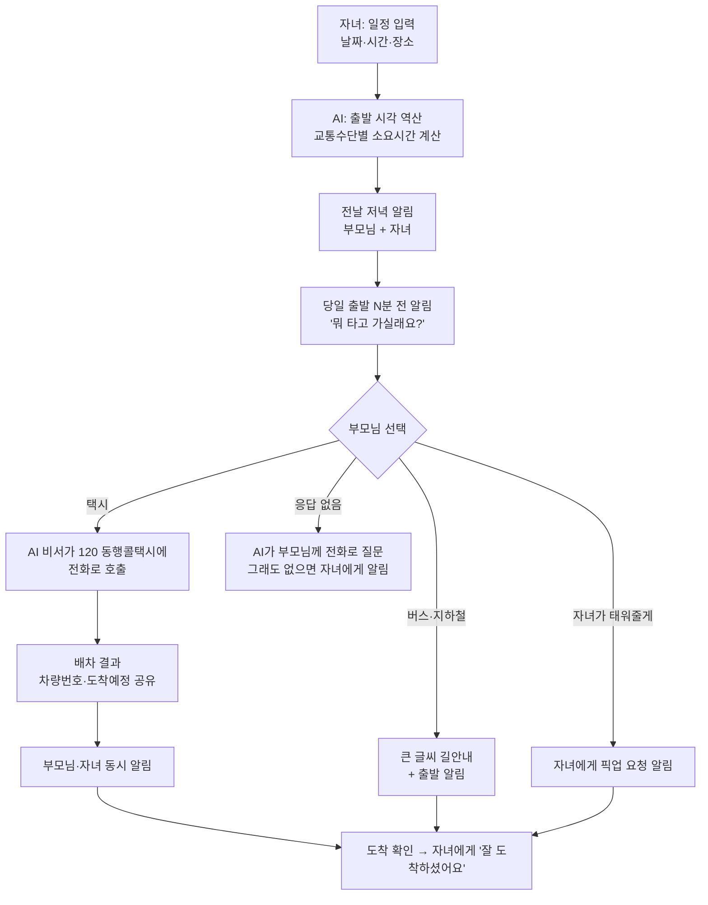
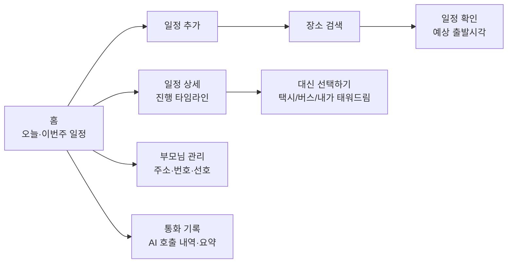
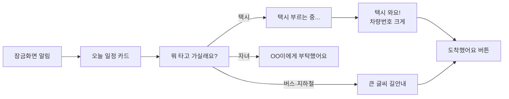

# 엄빠어디가 — 기능 설계 & 화면 흐름

> **엄빠어디가**: 엄마·아빠의 일정을 자녀가 입력해두면, 당일에 알림을 보내고, 어떤 교통수단으로 갈지 물어보고,
> 동선을 비교해 보여주고, 택시가 필요하면 **AI 비서가 대신 전화로 택시를 불러주는** 앱.

---

## 1. 사용자

| 역할 | 누구 | 주로 하는 일 |
|---|---|---|
| **보호자 (자녀)** | 앱 설치·설정 담당 | 부모님 등록, 일정 입력, 진행 상황 확인, 결제 |
| **부모님** | 스마트폰이 익숙하지 않음 | 알림 받기, 큰 버튼 하나 누르기 (또는 전화로 대답만) |
| **AI 비서** | 시스템 | 알림, 질문, 경로 계산, 택시 호출 전화, 결과 공유 |

설계 원칙: **부모님은 "누르기 1번" 또는 "말하기"만 한다.** 복잡한 입력은 모두 자녀 쪽에서 한다.

---

## 2. 핵심 흐름 한눈에 보기



---

## 3. 기능 설계

### 3.1 가족 연결
- 자녀가 가입 → 부모님 프로필 추가 (이름, 휴대폰 번호, 집 주소, 자주 가는 곳)
- 부모님 폰에는 **간편 모드 앱** 설치 (큰 글씨, 버튼 3개 이하) — 또는 앱 없이 **전화·문자만으로 이용** 가능
- 엄마·아빠 각각 등록, 형제자매 여러 명이 보호자로 참여 가능

### 3.2 일정 입력 (자녀)
- 필드: 누구 / 날짜·시간 / 장소(검색) / 종류(병원·모임·경조사·기타) / 메모(예: "공복으로 가셔야 함")
- 반복 일정: "매주 화요일 10시 물리치료"
- 빠른 입력: 카톡 메시지나 병원 예약 문자를 붙여넣으면 AI가 날짜·시간·장소를 뽑아냄
- 기본 교통수단 선호 저장 (예: 엄마는 무릎 때문에 택시 선호)

### 3.3 알림
| 시점 | 대상 | 내용 |
|---|---|---|
| 전날 저녁 7시 | 부모님 + 자녀 | "내일 10시 OO병원 가셔요. 9시 20분쯤 나가시면 돼요." |
| 출발 60분 전 | 부모님 | "준비하실 시간이에요" + 메모 내용 |
| 출발 30분 전 | 부모님 | **"뭐 타고 가실래요?"** (선택 화면) |
| 무응답 10분 | 부모님 | AI가 **전화**로 질문 ("택시 불러드릴까요? 1번 택시, 2번 버스") |
| 계속 무응답 | 자녀 | "엄마가 아직 답이 없으세요" + 대신 선택 버튼 |

알림 채널: 앱 푸시 → 카카오 알림톡 → 문자 → AI 음성 전화 (부모님 설정에 따라)

### 3.4 동선 비교
출발 30분 전 시점의 실시간 정보로 계산:

| 항목 | 택시 | 버스·지하철 | 자녀 차량 |
|---|---|---|---|
| 소요시간 | ✓ | ✓ | ✓ |
| 예상 비용 | ✓ (예상 요금) | ✓ | — |
| 걷는 거리 | 거의 없음 | ✓ (어르신에게 중요) | 거의 없음 |
| 환승 횟수 | — | ✓ | — |
| 계단·엘리베이터 | — | ✓ (가능하면) | — |

- AI가 하나를 **추천**: "비가 오고 걷는 거리가 800m라 오늘은 택시를 추천드려요"
- 데이터: 카카오/네이버/TMAP 길찾기 API, 날씨 API

### 3.5 AI 비서 택시 호출 (전화)

**왜 전화인가**: 카카오T 등은 일반 개발자에게 호출 API를 열어두지 않음. 반면 서울시
**'동행 온다콜택시'**는 사람이 전화로 출발지·목적지를 말하면 배차해주고, 배차 정보를
문자/알림톡으로 보내준다. → **AI가 그 전화를 대신 건다.**

- 번호: 다산콜센터 **02-120 → 6번**, 또는 전용 **1855-0120** (AI는 메뉴 없는 전용번호 우선)
- 운영 시간: 오전 8시~밤 10시 (변동 가능 — 운영 시간 밖이면 다른 수단 안내)
- 호출료: 08~22시 무료

**AI 통화 순서**
1. 발신 → 연결되면 먼저 고지: "안녕하세요, OOO 어르신을 대신해 택시를 부탁드리는 AI 비서입니다."
2. 출발지 (도로명 주소 + 건물 특징: "OO아파트 정문")
3. 목적지 (병원 이름 + 주소)
4. 탑승자 연락처: **부모님 휴대폰 번호** (배차 문자가 부모님께 가도록)
5. 상담원 질문에 응답 (휠체어 여부, 인원 등 — 미리 저장된 정보 사용)
6. 배차 정보(차량번호, 도착 예정) 확인 후 복창하고 종료
7. 통화 결과를 부모님·자녀에게 공유

**실패 처리**
| 상황 | 대응 |
|---|---|
| 통화 중 / 대기 길어짐 | 1분 간격 최대 3회 재시도, 동시에 자녀에게 알림 |
| 배차 실패 ("주변에 차가 없어요") | 5분 뒤 재시도 + 자녀에게 "카카오T 대신 불러주기" 버튼 제공 |
| AI가 상담원 말을 이해 못함 | 정중히 사과 후 종료 → 자녀에게 직접 통화 요청 |
| 운영 시간 외 | 처음부터 택시 옵션에 "AI 호출 불가 시간" 표시 |

**기술 구성 (안)**
- 전화망: 국내 발신이 가능한 클라우드 전화 서비스 (예: NHN Cloud, KT 기업용 API, Twilio 국내 번호 등 비교 필요)
- 음성: 실시간 STT(음성→텍스트) + LLM(대화) + TTS(텍스트→음성)
- 통화 녹음·요약 저장 (분쟁 대비, 부모님·자녀 동의 받아서)

### 3.6 진행 상황 공유 (자녀)
- 타임라인: 알림 보냄 → 엄마가 '택시' 선택 → AI 통화 중 → 배차 완료(서울12가3456, 7분 후 도착) → 탑승 → 도착
- 도착 확인: 부모님 위치(동의 시) 또는 부모님이 "도착했어요" 버튼

---

## 4. 화면 흐름

### 4.1 자녀 앱



**S1 홈**
```
┌─────────────────────────────┐
│ 오늘                         │
│ ┌─────────────────────────┐ │
│ │ 👩 엄마  10:00 OO정형외과 │ │
│ │ 🚕 택시 배차 완료 · 7분 후 │ │
│ └─────────────────────────┘ │
│ 이번 주                      │
│  목 14:00 👨 아빠 동창회      │
│  토 11:00 👩 엄마 물리치료    │
│                              │
│            [ + 일정 추가 ]    │
└─────────────────────────────┘
```

**S2 일정 추가**
```
┌─────────────────────────────┐
│ 누구?   [엄마] [아빠] [둘 다] │
│ 언제?   11월 12일(화) 10:00   │
│ 어디?   🔍 OO정형외과         │
│ 종류?   병원 ▾               │
│ 메모    공복으로 가셔야 함     │
│ 반복    없음 ▾               │
│ 📋 예약 문자 붙여넣기 (AI)    │
│              [ 저장 ]        │
└─────────────────────────────┘
```

**S5 일정 상세 (당일)**
```
┌─────────────────────────────┐
│ 엄마 · OO정형외과 10:00       │
│ ✔ 08:20 준비 알림 보냄        │
│ ✔ 08:50 '택시' 선택하심       │
│ ✔ 08:51 AI 비서 120 통화      │
│ ✔ 08:53 배차 완료             │
│    서울12가3456 · 9:00 도착   │
│ ○ 탑승                       │
│ ○ 도착                       │
│ [통화 요약 보기] [엄마께 전화] │
└─────────────────────────────┘
```

### 4.2 부모님 앱 (간편 모드)



**P3 뭐 타고 가실래요?** (가장 중요한 화면)
```
┌─────────────────────────────┐
│  10시 OO정형외과              │
│  뭐 타고 가실래요?            │
│                              │
│ ┌─────────────────────────┐ │
│ │ 🚕 택시        추천 👍    │ │
│ │ 15분 · 약 9,000원         │ │
│ └─────────────────────────┘ │
│ ┌─────────────────────────┐ │
│ │ 🚌 버스        35분       │ │
│ │ 1,500원 · 걷기 600m       │ │
│ └─────────────────────────┘ │
│ ┌─────────────────────────┐ │
│ │ 🚗 민지가 태워줘          │ │
│ └─────────────────────────┘ │
│     🔊 소리로 듣기            │
└─────────────────────────────┘
```
- 글씨 최소 24pt, 버튼 높이 80dp 이상, 음성 읽어주기 기본 제공

**P5 택시 와요!**
```
┌─────────────────────────────┐
│   🚕 택시가 와요!             │
│                              │
│      서울 12가 3456          │
│      흰색 쏘나타              │
│      9시 00분 도착            │
│                              │
│  [ 📞 기사님께 전화 ]         │
│  [ 📞 민지에게 전화 ]         │
└─────────────────────────────┘
```

### 4.3 앱 없는 부모님 (전화 모드)
1. 출발 30분 전 AI가 전화: "엄마, 10시 정형외과 가실 시간이에요. 택시 불러드릴까요? 택시는 1번, 버스는 2번, 민지한테 부탁하시려면 3번 누르세요." (말로 대답해도 됨)
2. 택시 선택 → AI가 120 호출 → 배차되면 다시 전화나 문자로 차량번호 안내
3. 모든 과정은 자녀 앱 타임라인에 기록

---

## 5. MVP 범위 (1차)

| 포함 | 나중에 |
|---|---|
| 자녀 일정 입력, 부모님 등록 | 예약 문자 AI 파싱 |
| 전날·당일 푸시/문자 알림 | 부모님 위치 기반 도착 확인 |
| 교통수단 선택 화면 + 경로 비교 (택시/대중교통) | 계단·엘리베이터 정보 |
| **AI 전화 호출 (서울 120 동행 온다콜택시)** | 서울 외 지역 콜센터 연동 |
| 자녀 타임라인 | 형제자매 분담, 결제 |
| 실패 시 자녀에게 넘기기 | AI 음성 전화로 부모님께 질문 |

---

## 6. 먼저 확인해야 할 것 (리스크)

1. **AI 전화 허용 여부** — 120/동행콜택시 콜센터에 AI 음성이 전화하는 것을 받아주는지
   **서울시에 사전 문의·협의 필요.** 상담원이 AI임을 알 수 있도록 통화 시작 시 반드시 고지.
   (2026년 9월 서울시의회에서 '120 동행콜택시 AI 활용' 제안이 나온 적 있음 → 협력 여지 있음)
2. **대리 호출 규정** — 탑승자가 아닌 제3자(AI)가 호출해도 되는지, 배차 문자를 부모님 번호로
   받을 수 있는지 확인
3. **서비스 대상** — 동행 온다콜택시가 고령자 대상이라 연령 등 이용 조건이 있는지 확인
4. **운영 시간·지역** — 오전 8시~밤 10시, 서울. 범위 밖은 대중교통/자녀 차량으로 안내
5. **개인정보** — 부모님 주소·번호·통화 녹음 → 부모님 본인 동의 절차 필요
6. **통화 비용** — 콜센터 대기 시간이 길면 통화료 증가 → 대기 상한 설정

---

## 참고
- [“앱 대신 전화”…고령자 대상 ‘온다 콜택시’, 120으로도 부른다](https://www.heraldk.com/article/2026070604253722722)
- [120+6 누르면 택시 온다! '120 동행콜택시' 이용해 보니 (서울시 미디어허브)](https://mediahub.seoul.go.kr/archives/2019067)
- [어르신, 콜택시도 120으로 신청하세요 (서울시 미디어허브)](https://mediahub.seoul.go.kr/archives/2018674)
- [이인화 서울시의원 “120 동행콜택시, AI 활용한 호출 불편 개선 제안”](https://m.go.seoul.co.kr/news/2026/09/07/20260907500201)
